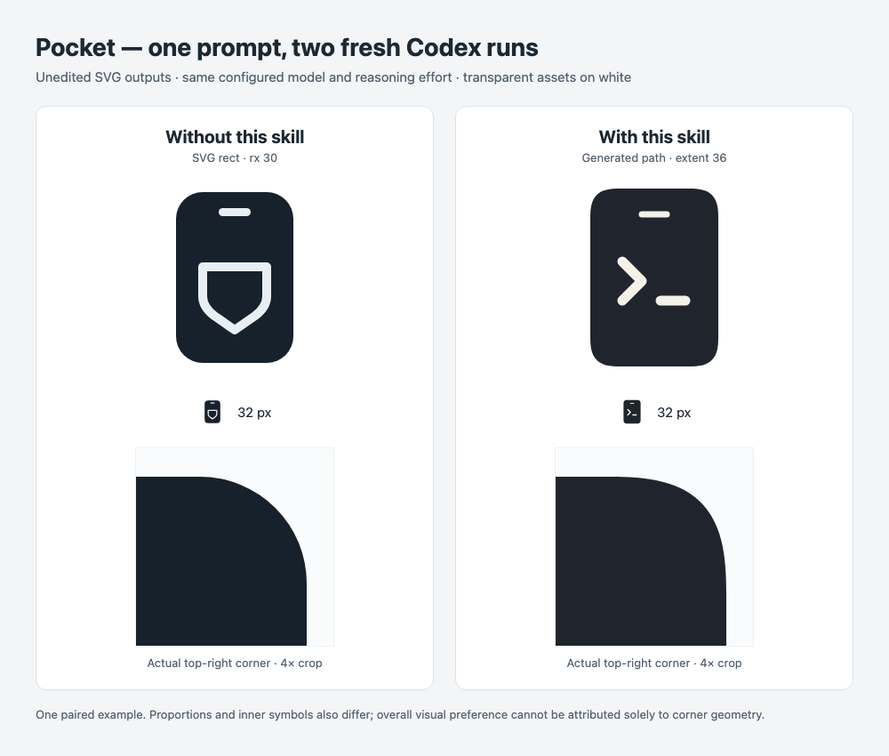

# Continuous Corners

[简体中文](README.zh-CN.md) · [Agent instructions](SKILL.md) · [Generator usage](references/usage.md)

Help an agent notice and implement an easily overlooked design detail: how a prominent rounded silhouette transitions from a straight edge into a curve. The user can ask for a phone-themed logo without knowing the term *continuous curvature*.

The skill combines design judgment, a deterministic SVG/path/JSON generator, and artifact checks. It does not prescribe one corner style for every design or replace an established brand silhouette.

## A real case: the same prompt, with and without the skill

These are the unedited SVG outputs of two fresh Codex CLI sessions for **Pocket**, a fictional developer tool. The task was actually executed; neither image is a hand-made illustration of an expected result. This is a new demonstration mark, not the existing iphone-use logo.



[Original without-skill SVG](assets/pocket-case/without-skill.svg) · [Original with-skill SVG](assets/pocket-case/with-skill.svg) · [Case metadata and file hashes](assets/pocket-case/case.json)

Both sessions received the same original Chinese prompt, without naming the skill or mentioning corners:

```text
为一个名叫 Pocket 的开发者工具设计一个手机主题的 SVG logo。使用透明背景、深色主体和少量浅色细节，整体简洁，在 32px 时仍能辨认。画布为 240×240，直接生成可编辑的 logo.svg。只在当前项目目录内完成工作，不发布。
```

In English: create a simple phone-themed SVG logo for Pocket, with a transparent 240 × 240 canvas, a dark body, a few light details, and legibility at 32 px.

| Observation | Without this skill | With this skill |
| --- | --- | --- |
| Phone body | SVG `<rect width="132" height="192" rx="30">` | Generated path, 144 × 200, extent 36 |
| Corner construction | Circular arcs joined to straight edges | Fixed local-superellipse profile exported as G2-constrained cubics |
| Agent behavior | Drew the SVG directly | Automatically read the skill and executed its generator |
| Reproducibility | Radius and dimensions in SVG | Profile id, dimensions, extent, and generator metadata in SVG |
| Output inspection | Both original artifacts retained | All body path command/number tokens match generator output |

**What this demonstrates:** in this run, installing the skill changed the agent's corner decision and implementation without adding specialist terminology to the user's request. The enlarged corners show the resulting transition; the 32 px row keeps the practical scale visible.

**What it does not demonstrate:** the two sessions also chose different proportions, colors, and interior symbols. Overall visual preference cannot be attributed solely to corner geometry. The circular version is a valid design choice, and the small-size difference is modest. One pair is not a trigger-rate benchmark, proof of better aesthetics, or a promise of Apple/Figma parity.

The runs used Codex CLI 0.167.0, configured `gpt-6-astra` with `high` reasoning, on 2026-11-08. Each used a fresh temporary Git project and an ephemeral session. Only the with-skill project contained this skill; other installed skills remained available. No model override, parent conversation, or explicit skill invocation was supplied. This was a practical demonstration, not a hermetic environment benchmark. Raw traces remain in ignored local evidence; the public bundle retains sanitized originals and case metadata.

## Design principles

### 1. Decide whether the contour matters

Phone silhouettes, app-icon containers, and prominent rounded marks are useful candidates. The skill makes this decision visible during generation rather than requiring the user to supply the technical vocabulary.

It respects the requested scope. Color-only edits, text changes, export-only work, and exact-preservation requests do not authorize geometry replacement. Existing brand rules and intentional circular or angular shapes take precedence.

### 2. Control curvature, not just tangent direction

A circular corner meets a straight edge with matching tangent direction (G1), but its ideal curvature changes abruptly from `0` to `1/r`. A G2 join also matches curvature, allowing bending to start gradually from zero. This can change the perceived edge transition without a visible kink.

The bundled reference is a **local superellipse**: a unit corner satisfies `x^n + (1-y)^n = 1`, with `n ≈ 3.10628`. Each corner is uniformly scaled into its own footprint, so changing rectangle aspect ratio does not stretch the corner itself.

The analytical reference has G3 behavior at straight joins. The shipped SVG uses **16 cubic Bézier spans per corner with G2 constraints and numerical checks**. It does not promise exact G3 output, a certified global error bound, or an exact Apple implementation. See [the geometry notes](references/geometry.md) for the assumptions and error semantics.

### 3. Use a reproducible tool, then inspect the composition

The generator ships with the skill and works offline with Node.js 22+. It emits SVG, path data, or JSON commands from a frozen, versioned profile. No runtime solver, npm dependency, or sibling source checkout is required.

`extent` means the corner's footprint along adjacent edges. It is not a circle radius and cannot be equated directly with an Apple/Figma radius. Values cap at half the shorter side; tiny positive extents outside the numerical domain are rejected. The tool creates a new output file and refuses to overwrite an existing one.

The agent still needs to inspect small-size recognition, composition, spacing, stroke clipping, and the final integrated path. Geometry checks support that judgment; they do not replace it. Native UI facilities or an existing project implementation may be more appropriate for a platform component.

## Install and use

Install into a project from its directory, or add `-g` for a user-level installation:

```sh
npx skills add hughlee824/skills --skill continuous-corners -a codex
# Or target Claude Code:
npx skills add hughlee824/skills --skill continuous-corners -a claude-code
```

For an unpublished branch, replace `hughlee824/skills` with the local repository path. Start a fresh session after installation when testing discovery. Automatic selection depends on the host and task; it is not guaranteed for every design request.

Explicit invocation is also available:

```text
# Codex
$continuous-corners Design a phone-themed SVG logo for Pocket.

# Claude Code, skills CLI/manual installation
/continuous-corners Design a phone-themed SVG logo for Pocket.
```

For marketplace installation, use `/plugin install continuous-corners@hughlee-skills` after adding this repository's marketplace; its namespaced invocation is `/continuous-corners:continuous-corners`.

To run the generator directly, set `SKILL_DIR` to the installed folder containing `SKILL.md`:

```sh
node "$SKILL_DIR/scripts/generate.mjs" \
  --width 144 --height 200 --extent 36 \
  --fill '#20252D' --output phone-body.svg
```

This generates the body silhouette, not the complete case-study logo. See [usage](references/usage.md) for formats, numerical limits, placement, and no-overwrite behavior.

## Validation and limits

The repository includes generator tests and behavior cases for implicit selection, color-only edits, and explicit skill loading under a geometry-preservation constraint. Actual fresh Codex sessions have demonstrated the phone-logo positive and color-only negative cases. Claude Code installation and marketplace metadata were checked; Claude model behavior was not tested. The example does not establish performance or suitability for every web/Android component.

To reproduce the behavior comparison, use two fresh projects with the same configured model and raw prompt, install this skill in only one, and retain both outputs and traces. Do not tell the baseline agent which corner geometry it should use, and do not select only aesthetically favorable outputs. Check the actual SVG construction and generated coordinates as well as the previews.

Instructions and wrapper: [Apache-2.0](LICENSE). Bundled geometry runtime: [MIT](scripts/vendor/continuous-corners/LICENSE), with provenance in [NOTICE](NOTICE).
