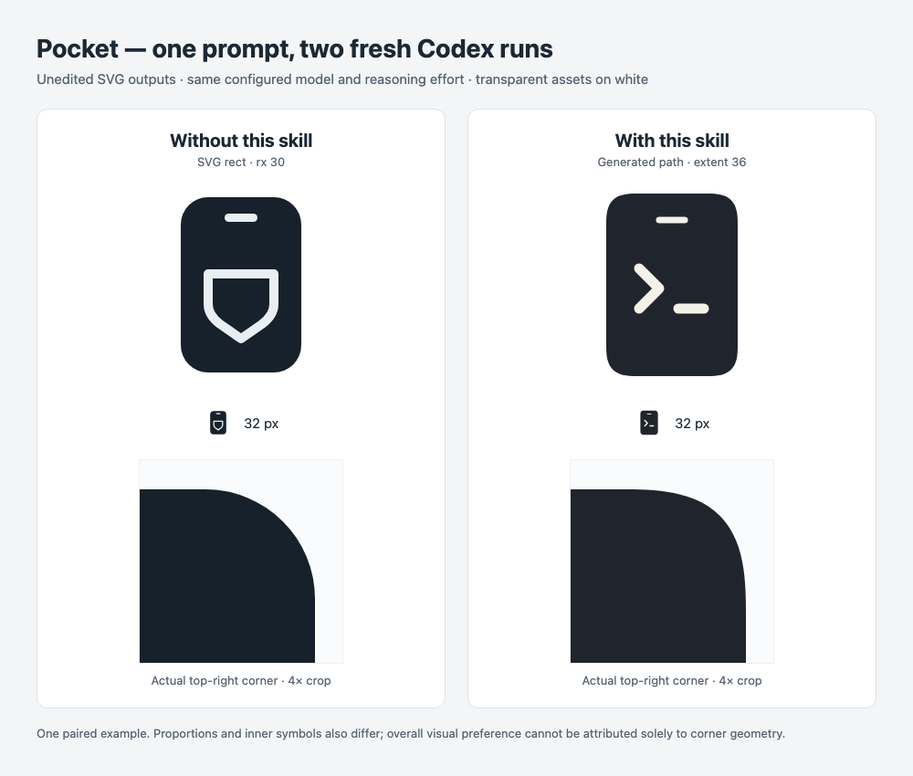

# Continuous Corners

[English](README.md) · [Agent 指令](SKILL.md) · [生成工具说明](references/usage.md)

帮助 agent 在设计时考虑一个容易遗漏的细节：显著圆角轮廓如何从直边过渡到曲线。用户只需要提出“设计一个手机主题的 logo”，不必先知道“连续曲率”这个术语。

Skill 结合设计判断、确定性的 SVG/path/JSON 生成工具与产物检查。它不会要求所有设计使用同一种圆角，也不会擅自替换已有品牌轮廓。

## 真实案例：相同提示词，安装与未安装 Skill

下面是两个全新 Codex CLI 会话为虚构开发者工具 **Pocket** 生成的原始 SVG。任务确实执行过，两张图都没有经过手工修改来配合预期结论。这是新的演示图形，现有 iphone-use logo 没有改变。



[未安装时的原始 SVG](assets/pocket-case/without-skill.svg) · [安装后的原始 SVG](assets/pocket-case/with-skill.svg) · [案例参数与文件哈希](assets/pocket-case/case.json)

两个会话收到完全相同的提示词，其中没有点名 Skill，也没有提到圆角：

```text
为一个名叫 Pocket 的开发者工具设计一个手机主题的 SVG logo。使用透明背景、深色主体和少量浅色细节，整体简洁，在 32px 时仍能辨认。画布为 240×240，直接生成可编辑的 logo.svg。只在当前项目目录内完成工作，不发布。
```

| 观察项 | 未安装 Skill | 安装 Skill |
| --- | --- | --- |
| 手机主体 | SVG `<rect width="132" height="192" rx="30">` | 生成的路径，144 × 200，extent 为 36 |
| 圆角构造 | 圆弧与直线相接 | 固定局部超椭圆 profile，以带 G2 约束的三次 Bézier 导出 |
| Agent 行为 | 直接绘制 SVG | 自动读取 Skill，并执行生成工具 |
| 可复现信息 | SVG 中的半径与尺寸 | SVG 中的 profile、尺寸、extent 与生成器元数据 |
| 产物核验 | 保留原始产物 | 主体路径的所有命令和数值均与生成器输出一致 |

**这个案例说明：** 在这次任务中，安装 Skill 改变了 agent 对圆角的选择和实现方式，用户无需额外补充专业术语。局部放大可以看清过渡差异，32px 一行则保留了实际小尺寸效果。

**它不能说明：** 两次生成的比例、颜色、内部符号也不同，因此不能把整体审美差异都归因于圆角。普通圆弧版本同样是有效的设计选择，小尺寸下的差异也较有限。一组案例不能证明稳定触发率、普遍更好看，或与 Apple/Figma 完全一致。

运行条件：2026-11-08，Codex CLI 0.167.0，配置为 `gpt-6-astra`、`high` reasoning。每次使用独立的临时 Git 项目和全新临时会话；只有右侧项目安装了本 Skill，其他已安装的 skills 仍可用。没有覆写模型、传入本对话历史或显式调用 Skill。这是实际使用示例，不是完全隔离环境的基准实验。原始调用记录保留在忽略的本地证据目录；公开内容只包含经过检查的原始 SVG、对照图与案例参数。

## 设计原理

### 1. 先判断轮廓是否值得处理

手机轮廓、App 图标底形和显著圆角 mark 都是候选场景。Skill 的作用是让 agent 在生成过程中考虑这个决定，减少对用户专业词汇的依赖。

它也必须尊重修改范围。只改颜色、文字、导出格式，或者要求精确保留形状时，都不应替换几何。既有品牌规则，以及刻意采用的圆弧或棱角，应优先保留。

### 2. 不只连接方向，也约束弯曲程度

普通圆弧圆角与直线连接时，切线方向一致，即 G1；但理想几何中的曲率会从直线的 `0` 突然变为圆弧的 `1/r`。G2 连接进一步要求曲率匹配，让弯曲程度从零逐渐增加，从而改变边缘过渡的视觉特征。

随附实现以**局部超椭圆**作为参考：单位圆角满足 `x^n + (1-y)^n = 1`，其中 `n ≈ 3.10628`。每个圆角在自己的局部区域中等比缩放，因此调整矩形宽高比不会把圆角本身拉伸。

解析参考曲线与直线连接处具有 G3 行为；实际 SVG 使用**每角 16 段带 G2 约束的三次 Bézier，并进行数值检查**。它不承诺精确 G3 导出、经过严格证明的全局误差界，也不声称复现 Apple 的私有实现。详细假设与误差含义见[几何说明](references/geometry.md)。

### 3. 确定性生成，再检查整体设计

工具随 Skill 一起安装，使用 Node.js 22+ 离线运行，根据固定版本 profile 输出 SVG、路径或 JSON 命令；不需要运行时求解器、npm 依赖或旁边另一个源码仓库。

`extent` 表示圆角沿相邻两条边占用的长度，不是圆的半径，不能直接当成 Apple/Figma 的 radius。超过短边一半时会截断；小于数值精度要求的正值会被拒绝。工具只创建新文件，不覆盖已有产物。

Agent 仍需检查小尺寸辨识度、构图、留白、描边裁切，以及集成后是否保留原始路径精度。几何检查为视觉判断提供依据，不能替代视觉判断。针对原生界面或现有项目，平台内置能力或已有组件实现可能更合适。

## 安装与使用

在项目目录中安装，或加 `-g` 进行用户级安装：

```sh
npx skills add hughlee824/skills --skill continuous-corners -a codex
# 或安装到 Claude Code：
npx skills add hughlee824/skills --skill continuous-corners -a claude-code
```

验证尚未发布的分支时，将 `hughlee824/skills` 换成本地仓库路径。安装后通过全新会话测试发现机制。自动选择取决于宿主和任务，不保证所有设计请求都会触发。

也可以显式调用：

```text
# Codex
$continuous-corners 为 Pocket 设计一个手机主题的 SVG logo。

# Claude Code，通过 skills CLI 或手动安装
/continuous-corners 为 Pocket 设计一个手机主题的 SVG logo。
```

通过 marketplace 安装时，先添加本仓库 marketplace，再运行 `/plugin install continuous-corners@hughlee-skills`；对应的完整调用名为 `/continuous-corners:continuous-corners`。

直接运行生成工具时，把 `SKILL_DIR` 设置为安装后包含 `SKILL.md` 的目录：

```sh
node "$SKILL_DIR/scripts/generate.mjs" \
  --width 144 --height 200 --extent 36 \
  --fill '#20252D' --output phone-body.svg
```

这条命令只生成主体轮廓，不会生成案例中的完整 logo。输出格式、数值范围、路径放置和拒绝覆盖行为见[工具说明](references/usage.md)。

## 验证范围与限制

仓库包含生成工具测试，以及自然触发、仅改颜色、显式加载 Skill 但要求保持几何等行为用例。真实的全新 Codex 会话已通过手机 logo 正例和仅改颜色反例。Claude Code 完成了安装与 marketplace 元数据校验，没有验证其模型行为。这个案例也不能证明所有 Web/Android 组件的性能或适用性。

复现对照时，在两个全新项目中使用相同模型配置与原始提示词，只给其中一个安装 Skill，并保留两边输出和调用记录。不要提示基线 agent 使用哪种圆角，也不要只挑选视觉上有利的结果。除图片外，还应检查实际 SVG 构造与生成坐标。

指令与工具封装采用 [Apache-2.0](LICENSE)；随附几何实现保留 [MIT 许可证](scripts/vendor/continuous-corners/LICENSE)与 [NOTICE](NOTICE) 中的来源说明。
